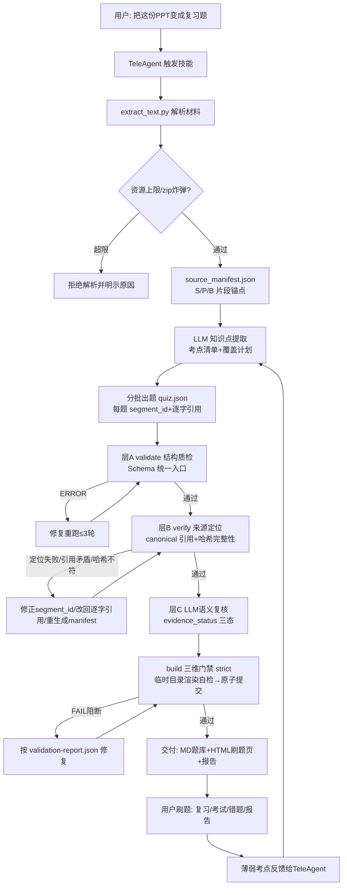

# 点课成题-课件刷题工坊——项目架构与技能执行流程

## 一、系统架构（组件视图）

```
┌─────────────────────────────────────────────────────────────────┐
│                       TeleAgent 宿主运行时                        │
│  （对话触发 · 模型调用 · 技能调度；模型处理材料属宿主运行时行为）    │
└───────────────┬─────────────────────────────────────────────────┘
                │ 自然语言触发（"帮我把这份PPT变成复习题"…）
                ▼
┌─────────────────────────────────────────────────────────────────┐
│                Skill: courseware-quiz-builder（点课成题-课件刷题工坊）          │
│                                                                  │
│  SKILL.md ── 触发与九步工作流（LRM 加载）                          │
│     │                                                            │
│     ├── references/quiz-format.md        # quiz.json 数据契约      │
│     ├── references/generation-workflow.md# 出题流程规范             │
│     │                                                            │
│     ├── scripts/extract_text.py ────── 确定性：材料解析             │
│     │      输入: 课件文件（pptx/docx/pdf/txt/md）                  │
│     │      输出: extracted.txt + source_manifest.json + imgs/     │
│     │      防护: zip炸弹/大小/条目/压缩比上限；水印形状过滤          │
│     │                                                            │
│     ├── scripts/quiz_toolkit.py ────── 确定性：三层验证、反伪造与原子化门禁     │
│     │      validate → 层A 结构质检（统一 Schema 入口，含图片安全/解析-答案矛盾）     │
│     │      verify   → 层B 来源定位 + canonical 引用 + 材料 SHA-256 完整性       │
│     │      build    → 三维门禁（strict/preview）+ 临时目录渲染自检 + 原子提交   │
│     │      产出 validation-report.json（schema@2.2 三维契约+findings+逐题矩阵）   │
│     │                                                            │
│     └── assets/quiz-template.html ──── 离线刷题页（单文件）        │
│            首页 / 复习·考试 / 成绩解析 / 错题中心 / 学习报告         │
│            localStorage 持久化 + 导出导入 + 存储失败警示            │
└─────────────────────────────────────────────────────────────────┘
                │ 产出（普通文件，浏览器双击即用）
                ▼
   题库-<主题>.md ｜ 刷题页-<主题>.html ｜ 图片-<主题>/
```

**设计取舍**：不引入向量库/微服务/多 Agent 等基础设施——解析、验证、渲染三个环节全部由
两个标准库 Python 脚本承担（确定性、可离线审计），LLM 只做它擅长的事（知识点理解、出题、
语义复核），"模型出题 + 脚本把关"双机制使输出可被机器复验。

## 二、技能执行流程（时序）



## 三、数据契约（关键结构）

**source_manifest.json**（解析产物）：
```
source_id S1/S2… · sha256 · status(ok/needs-ocr/failed)
segment_id S1:P3（页）/ S1:B12（块）· label · chapter · text 原文 · images
```

**quiz.json**（题目 + 证据链，向后兼容）：
```
顶层: title/source_desc/topics[]/images{}/manifest
题目: 基础字段 + source_id + segment_id + source_quote(逐字)
      + evidence_status(semantic-pass/needs-review/unresolved)
      + verification_notes + topic_id + knowledge_type
```

**三层验证职责划分**：

| 层 | 执行者 | 证明什么 | 不证明什么 |
|---|---|---|---|
| A 结构 | 脚本 validate | 字段/题型/答案/查重/图片安全合法 | 内容对错 |
| B 定位 | 脚本 verify | 引用存在且可在材料片段中定位 | 学科正确性 |
| C 语义 | 宿主 LLM 自审 | 材料支持该题/答案（诚实三态标注） | —（needs-review 留给人工） |

**localStorage（v3 schema）**：examPaper（当前/最近试卷：attempt_id/qids/idx/submitted
+ 交卷后 answers/results/shortSelf/flags 深拷贝快照）/ answers / flags / results /
shortSelf / qHistory（每题作答历史，驱动错题判定与前后对比）/ attempts（历次成绩）。
考试状态机 IDLE→IN_PROGRESS→SUBMITTED→REVIEW：新卷新 attempt_id 清空当前作答、历史保留；
中途刷新恢复到进行中考试；重复交卷守卫；导入 Schema 校验（非法拒绝且状态不变，v2 自动迁移）。
存储失败→页面警示+导出兜底；key 含题数指纹避免同名题库串记录。

## 四、v2.2 三维状态契约与原子化构建（专章）

`build` 是正式交付的最后闸口，验证与产出不可分离；报告同时承载三个相互独立的状态维度，
消除 v2.1 “overall=WARN 但 blocked=true” 式的口径矛盾：

| 维度 | 取值 | 语义 |
|---|---|---|
| validation_status | PASS / WARN / NOT_VERIFIED / FAIL | 验证结论（FAIL > NOT_VERIFIED > WARN > PASS） |
| release_status | READY / DRAFT_ONLY / BLOCKED / NOT_APPLICABLE | 发布决策；**blocked ⟺ BLOCKED 恒等** |
| checks[].execution | EXECUTED / SKIPPED / UNAVAILABLE | 每项检查是否真正执行（无 manifest 时 layer_b=UNAVAILABLE） |

| 模式 | 阻断 | 放行 | 产物标注 |
|---|---|---|---|
| strict（默认） | 层A FAIL（含 A-IMG、A-EXPLAIN-CONSISTENCY、A-SCHEMA）、层B FAIL（B-SRC-LOCATE / B-REF-CONFLICT / B-SOURCE-HASH）、缺 manifest（B-MANIFEST-001/002）、证据剥离（B-EVIDENCE-STRIPPED）、**逐题证据缺失（B-EVIDENCE-REQUIRED）**、**语义未执行 NOT_VERIFIED**、语义 unresolved（C-SEM-003） | needs-review=WARN；短证据 B-QUOTE-THIN/UNIQUE=WARN | 无 |
| preview（显式） | 仅层A FAIL | 其余放行 | 文件名（草稿）+MD 头部+页面横幅（含“发布状态 DRAFT_ONLY”）+报告，四处标注 |

**原子化构建**：渲染在 `.build-tmp-{pid}` 临时目录完成并自检，通过后 `os.replace` 原子提交；
失败零半成品。阻断/失败时**旧正式产物保留**并整版警告“历史产物不代表本次验证结果”
（不静默删除、不让人误认）。退出码：0=承诺操作成功；1=验证失败/阻断/关键检查未执行；
2=用法/IO。

**反伪造机制**：`canonical_ref_of()` 由 manifest 结构化字段生成规范出处（如
“课件《good.pptx》第1页”）并优先渲染；`source_ref` 仅与真实定位交叉核对，矛盾即
B-REF-CONFLICT；`verify_source_files()` 按 `--source-root` 重算材料 SHA-256 与 manifest
比对（B-SOURCE-HASH）；短引用给出 THIN/UNIQUE 质量维度而非笼统“全部通过”。

`validation-report.json`（schema `courseware-quiz-builder/validation-report@2.2`）始终落盘：
command/tool_version/input_digest + 三维状态 + checks[] + 逐条 findings
（rule_id/severity/question_id/message/evidence/suggested_fix）+ 逐题三层矩阵。

**路径与内容安全**：图片仅允许 quiz.json 所在目录内相对路径或 data URL；包含判定用
`Path.resolve()+is_relative_to`（展开符号链接，不用字符串前缀比较）；`../`、`..\`、绝对路径、
协议外链、svg、伪装魔数分类拒绝并给出明确原因；单图 ≤20MB；前端二次白名单；
`js_safe_json` 全量转义 `<` 阻断 `</script>` 闭合；材料文本仅作数据，其中任何指令性
文字不执行（提示注入防护）。

**解析层健壮性**：extract_pptx/docx 任何早退/异常分支统一返回 (result, error) 二元组；
单文件隔离，混合批次坏文件不毁好文件；6 类边界文件（无 slides/缺 document.xml/空 body/
无文本/类型伪装/非 zip）明确报错无 Traceback。

> AI生成
